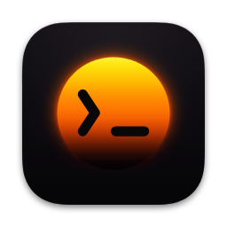
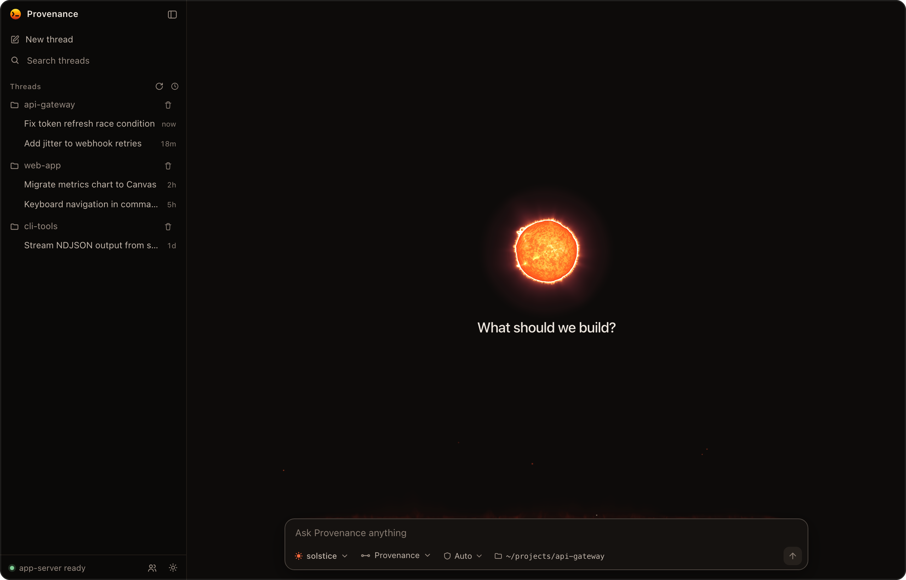
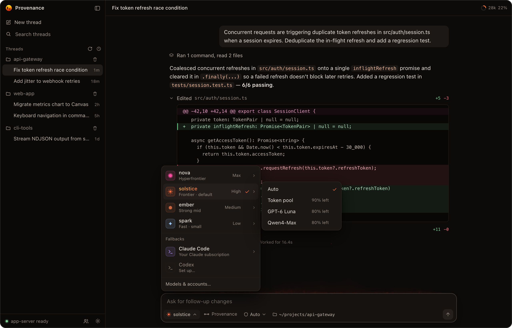
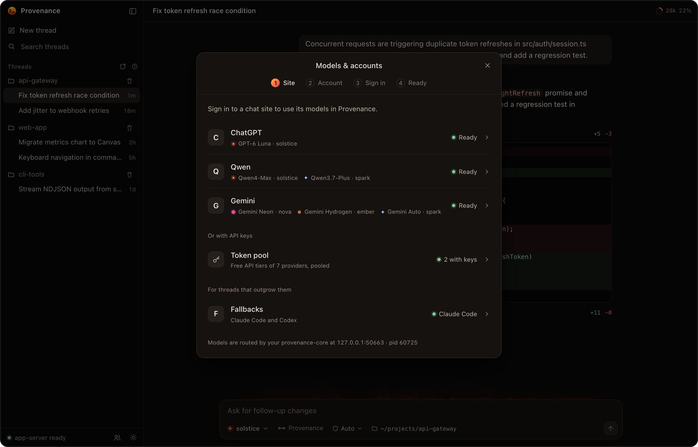

# Provenance

**A coding agent for your Mac and your terminal, running on pooled free-tier models.**

Pick a strength, not a model. Powered by [provenance-core](https://github.com/prominence-chan/provenance-core).

 

## Why

Provenance is a local coding agent — a native macOS app paired with a `provenance` terminal client — that routes through [provenance-core](https://github.com/prominence-chan/provenance-core) instead of tying you to a single paid subscription. Free-tier APIs and chat-site accounts you sign into are pooled behind one local endpoint and grouped into four tiers:

| Tier | Strength | Good for |
| --- | --- | --- |
| `nova` | Hyperfrontier | Hard architecture, deep debugging |
| `solstice` | Frontier *(default)* | Everyday coding and multi-file edits |
| `ember` | Strong mid-size | Focused edits, reviews, summaries |
| `spark` | Fast / small | Quick checks, lookups, bulk work |

Conversations stick to one model inside your chosen tier and fail over automatically when a provider hits a rate limit.

## What's inside

- **Desktop app & CLI** — Multi-project threads, inline file diffs, collapsed tool runs, command approvals, and light/dark themes in `Provenance.app`, plus an interactive `provenance` TUI and `provenance exec` in your terminal.
- **Built-in account & key setup** — Sign into chat sites or add free-tier API keys under **Models & accounts**. The macOS app bundles its own local `provenance-core` router and starts it automatically.
- **Long-thread orchestration & fallbacks** — Run standard or experimental multi-worker orchestrators, or hand a thread that outgrows free-tier context over to a local CLI fallback without losing where you left off.

## Inside the app

<table>
<tr>
<td width="50%" valign="top">

 
<strong>New thread</strong> — Reactive solar canvas paired with a project-grouped thread sidebar and orchestrator selector.
</td>
<td width="50%" valign="top">

 
<strong>Tiers &amp; live sources</strong> — Stay on Auto or pin a specific model source, with remaining quota shown right in the menu.
</td>
</tr>
<tr>
<td width="50%" valign="top">

 
<strong>Models &amp; accounts</strong> — Connect web chat accounts, free-tier API keys, and local CLI fallbacks in one place.
</td>
<td width="50%" valign="top">

 
<strong>Light theme</strong> — Warm daylight palette with the same inline diffs, context ring, and folded tool runs.
</td>
</tr>
</table>

## Install

1. Download `Provenance-0.1.0-arm64.dmg` from the [latest release](https://github.com/prominence-chan/provenance/releases/tag/provenance-app-v0.1.0) (Apple Silicon) and drag **Provenance** into **Applications**.
2. The app is ad-hoc signed rather than notarized, so the first launch needs a right-click → **Open** (or clear quarantine once — see [SETUP.md](SETUP.md)).
3. Open **Models & accounts** in the app to connect a chat site or add API keys, then start a thread.

Building from source, installing the `provenance` CLI, running the browser UI, and configuring environment variables or `~/.provenance/config.toml` are all in **[SETUP.md](SETUP.md)**.

## Docs

- **[SETUP.md](SETUP.md)** — Building the app and CLI from source, CLI usage, and configuration
- **[ui/README.md](ui/README.md)** — Desktop shell, frontend architecture, orchestrators, and test scripts
- **[docs/UPSTREAM.md](docs/UPSTREAM.md)** — Harness settings (`harness.toml`) and upstream sync guide

---

Licensed under <a href="LICENSE">Apache-2.0</a> (see <a href="NOTICE">NOTICE</a>). Agent runtime adapted from <a href="https://github.com/openai/codex">openai/codex</a>; not affiliated with or endorsed by OpenAI.
