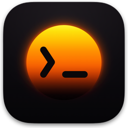
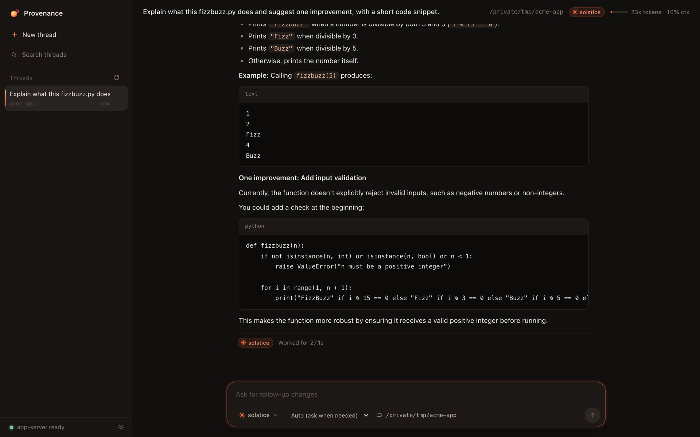
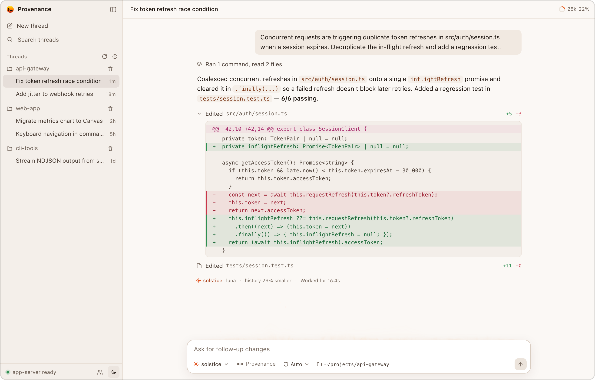

<h1>Provenance</h1>

**A coding agent for your desktop and terminal, running on pooled free-tier models.** 
Pick a strength, not a model. Powered by [provenance-core](https://github.com/prominence-chan/provenance-core).

 

  

## Why

Provenance is a local coding agent — a desktop app paired with a `provenance` CLI — backed by [provenance-core](https://github.com/prominence-chan/provenance-core). Instead of locking you into one paid subscription, it pools free-tier APIs and chat accounts you sign into behind one local endpoint and sorts them into four tiers:

| Tier | Strength | Good for |
| --- | --- | --- |
| `nova` | Hyperfrontier | Hard architecture, deep debugging |
| `solstice` | Frontier *(default)* | Everyday coding and multi-file edits |
| `ember` | Strong mid-size | Focused edits, reviews, summaries |
| `spark` | Fast / small | Quick checks, lookups, bulk work |

Threads stay on one model inside your chosen tier and fail over automatically when a provider hits a rate limit.

## What's inside

- **Desktop app & CLI** — Project-grouped threads, inline diffs, folded tool runs, subagent tracking, command approvals, and light/dark themes, paired with a `provenance` TUI and `provenance exec` in your terminal.
- **Built-in account & key setup** — Sign into chat sites or add free-tier API keys under **Models & accounts**. The desktop app ships with its own local `provenance-core` router and manages it automatically.
- **Orchestrators & fallbacks** — Pick between the standard harness, an experimental subagentic orchestrator, or a chat-optimized mode for web models, or move a long thread over to a local CLI fallback when it outgrows free-tier context.

## Inside the app

<table>
<tr>
<td width="50%" valign="top">

 
<strong>New thread</strong> — Reactive solar canvas paired with a project-grouped sidebar and orchestrator picker.
</td>
<td width="50%" valign="top">

 
<strong>Tiers &amp; live sources</strong> — Stay on Auto or pin a specific model source, with remaining quota right in the menu.
</td>
</tr>
<tr>
<td width="50%" valign="top">

 
<strong>Models &amp; accounts</strong> — Connect web chat accounts, free-tier API keys, and local CLI fallbacks in one place.
</td>
<td width="50%" valign="top">

 
<strong>Light theme</strong> — Warm daylight palette with the same inline diffs, context ring, and folded tool runs.
</td>
</tr>
</table>

## Install

1. Grab the latest installer for **macOS**, **Windows**, or **Linux** from [Releases](https://github.com/prominence-chan/provenance/releases).
2. On macOS, the app is ad-hoc signed rather than notarized, so the first launch needs a right-click → **Open** (or clear quarantine once — see [SETUP.md](SETUP.md)).
3. Open **Models & accounts** to sign into a chat site or add free-tier API keys, then start a thread.

Building from source, installing the `provenance` CLI, running the browser UI, and configuring environment variables or `~/.provenance/config.toml` are all in **[SETUP.md](SETUP.md)**.

## Docs

- **[SETUP.md](SETUP.md)** — Building the app and CLI from source, CLI usage, and configuration
- **[ui/README.md](ui/README.md)** — Desktop shell, frontend architecture, orchestrators, and test scripts
- **[docs/UPSTREAM.md](docs/UPSTREAM.md)** — Harness settings (`harness.toml`) and upstream sync guide

---

Licensed under <a href="LICENSE">Apache-2.0</a> (see <a href="NOTICE">NOTICE</a>). Agent runtime adapted from <a href="https://github.com/openai/codex">openai/codex</a>; not affiliated with or endorsed by OpenAI.
